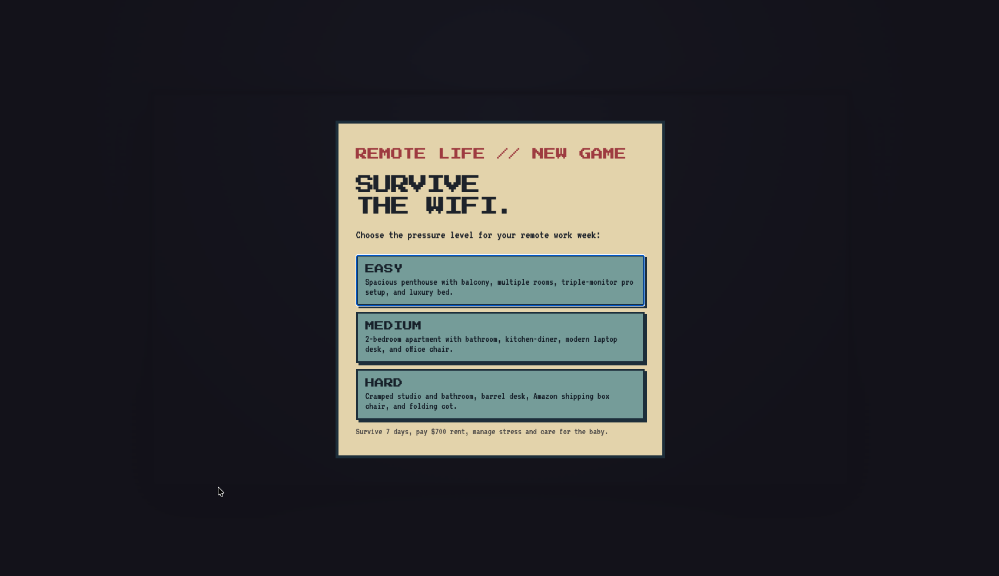
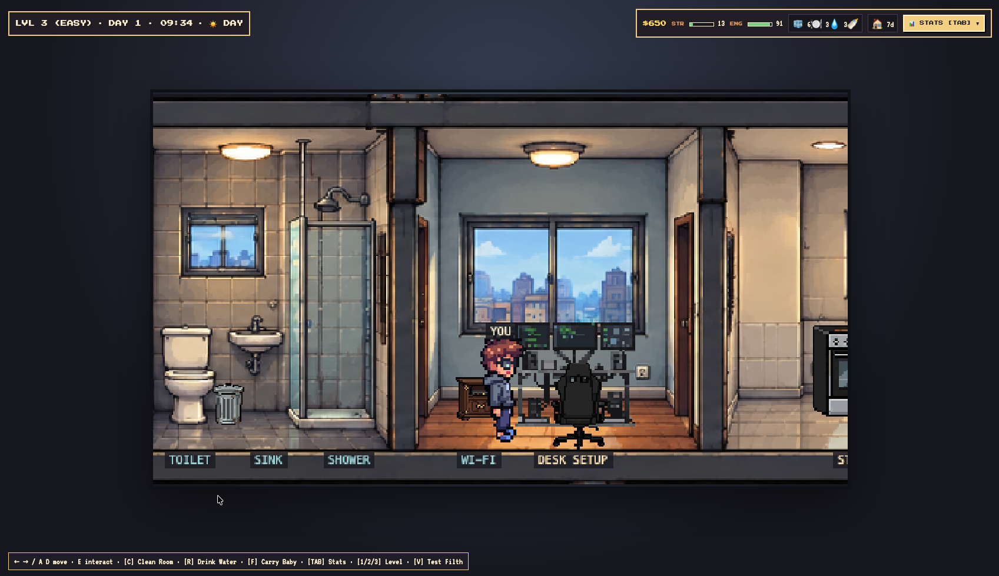
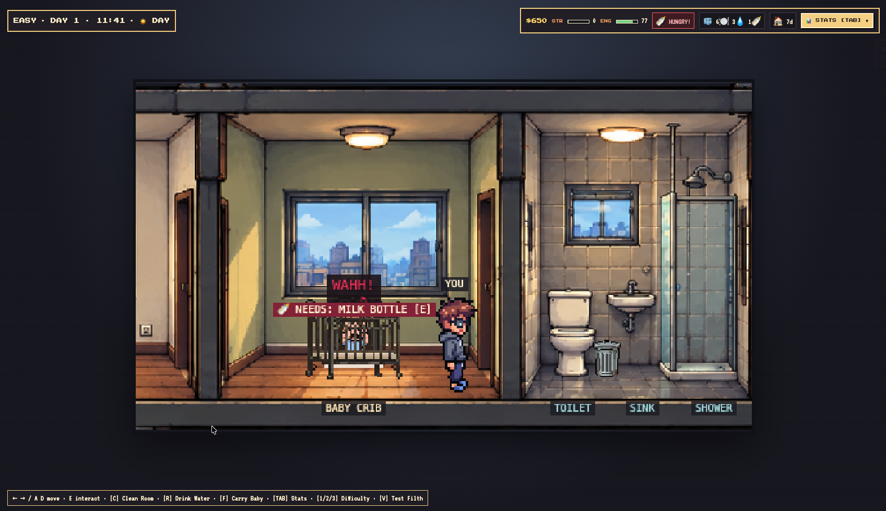
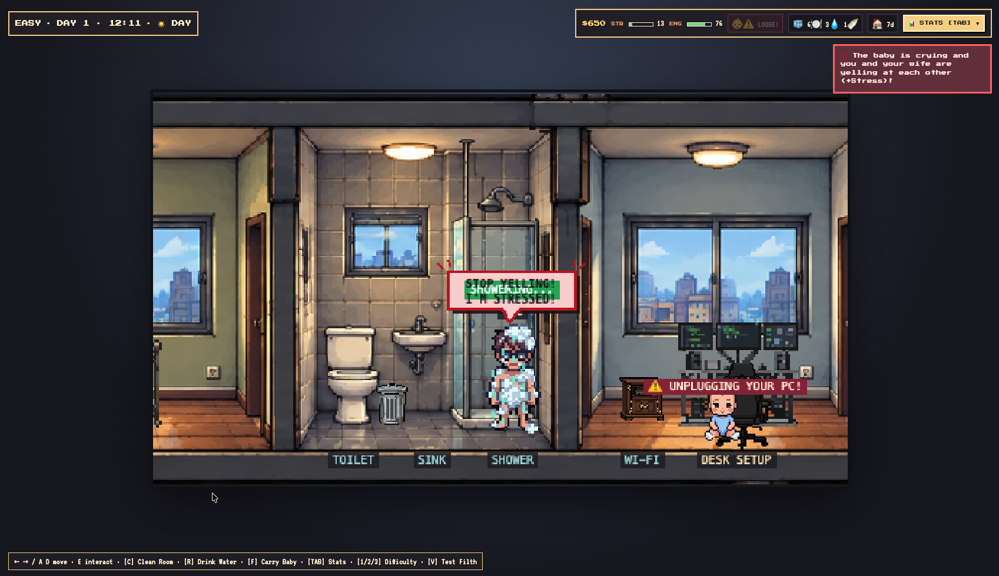
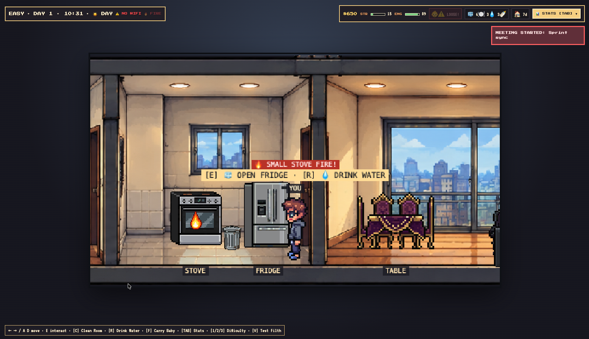
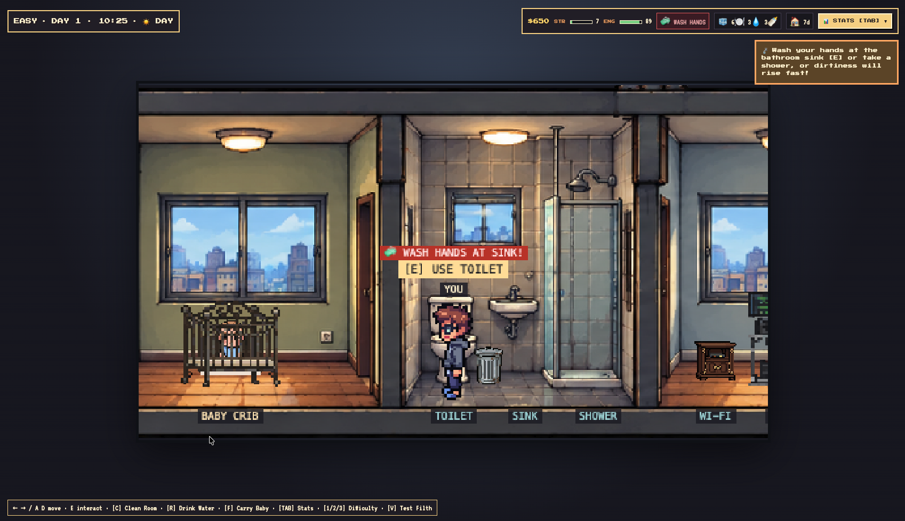
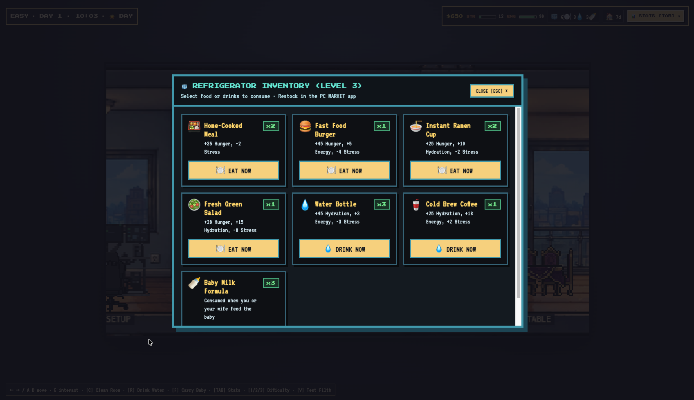
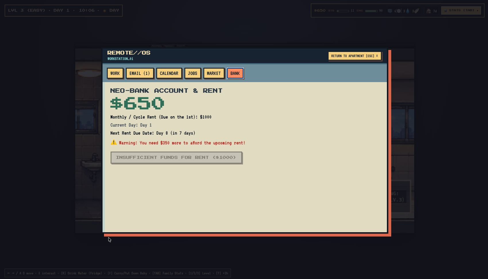

# 💻🔥 Remote Life — _Survive the Wi-Fi (or Die Trying)_

> **“In Remote Life, just like in real life, whenever one thing goes right… three others go wrong.”**
> Think working from home means pajamas and coffee? **Wrong.** You cannot rest here—because you only truly rest when you are dead. Take care of your wife before she starts yelling, feed the baby before they climb into the kitchen and set the apartment on fire, clean the bathroom before it fills with trash bags, wash your hands, answer the Team Lead during a video call, and deliver your tickets on time… or get ready to be fired, evicted, or divorced from stress.



---

## 🎮 What Is _Remote Life_?

**Remote Life** is a chaotic 2D pixel-art browser survival simulator where you play a remote developer trying to make it through the work week without losing your job, sanity, family, or home.

Every minute counts, and chaos never asks for permission:

- 💻 **Work or starve**: Take freelance assignments in `REMOTE//OS`, finish tickets before their deadlines, keep your reputation high, and survive the daily **10:30 AM** meeting without falling asleep on camera.
- 👶 **A baby with a pyromaniac streak**: When the baby cries, your stress rises. Ignore them for too long and they escape the crib to crawl around the apartment, **unplug your PC**, **turn off the Wi-Fi router**, **fall from the dining table**, or **set the kitchen on fire**—from a small flame to a full kitchen blaze and a _Game Over_.
- 👩 **Marriage under pressure**: Your wife has her own routine and needs. If the fridge is empty and she is hungry, or the baby will not stop crying, **comic-style speech bubbles and yelling** will fill the apartment, driving your stress to the limit.
- 🧹 **Hygiene, mess, and dignity**: Use the toilet and **wash your hands at the sink**—otherwise you will get dirty very quickly until flies surround you 🪰. Clean the rooms, bathroom, and kitchen before trash bins overflow, poop appears in the bathroom, or garbage bags pile up throughout the home.
- 🏢 **Money, moving, and your setup**: Cannot afford rent? Sell the sofa or TV to survive one more week, or open the market's **TRADE** tab to move to a cheaper apartment—even if it is ugly and raises your stress—or upgrade your desk and chair separately.

---

## 📸 Gallery of Chaos (_Screenshots_)

### 🏠 Your apartment, your office, your prison

Choose between three pressure levels—**EASY**, **MEDIUM**, or **HARD**—from a cramped studio with a barrel desk and cardboard-box chair to a triple-monitor penthouse with a city view.



### 🍼 The baby is hungry… and you have a delivery due in 10 minutes

Feed them formula, let them crawl when they want to play, or hold them until they fall asleep before putting them back in the crib.



### 🚨 When everything goes wrong at once!

You are taking a shower because you smell bad, your wife is yelling from the living room, the baby escaped the crib, and they are **unplugging your PC**…



### 🔥 A kitchen fire during the _Daily Sprint Sync_!

If you do not extinguish the fire while it is small (`fire_small`), it grows into giant flames (`fire_big`), consumes the kitchen, and ends your run.



### 🧼 Hygiene and home cleaning

After using the toilet, wash your hands at the sink and keep the kitchen and bathroom trash bins clean.



### 🧊 Manage your refrigerator supplies

Open the fridge to choose from home-cooked meals, burgers, ramen soup, salads, water bottles, cold brew, or baby milk.



### 💳 `REMOTE//OS` — Work, Market, Trade, and Bank

Use your computer to manage tasks (`WORK`), email (`EMAIL`), meetings (`CALENDAR`), side jobs (`JOBS`), purchases/trades/sales (`MARKET`), and rent payments (`BANK`).



---

## 🕹️ Controls

| Key                            | Action                                                                               |
| :----------------------------- | :----------------------------------------------------------------------------------- |
| **`A` / `D`** or **`←` / `→`** | Walk through the apartment                                                           |
| **`E`**                        | Interact with the current area: desk, crib, bed, fridge, TV, toilet, sink, or shower |
| **`F`**                        | Hold the baby / place them in the crib or bed / let them crawl on the floor          |
| **`C`**                        | Clean the current room: bedroom/living room, bathroom, or kitchen                    |
| **`R`**                        | Quickly drink water in front of the refrigerator                                     |
| **`TAB`**                      | Open or close the detailed family-stat panel: **YOU**, **WIFE**, **BABY**            |
| **`ESC`**                      | Close the `REMOTE//OS` computer or refrigerator window                               |
| **`1` / `2` / `3`**            | Quickly switch to **HARD**, **MEDIUM**, or **EASY** difficulty outside the computer  |

---

## 🛠️ Technology

- **[Phaser 3](https://phaser.io/) (`v3.90`)** — HTML5 2D engine for pixel-art apartment rendering, layered animations, dynamic day/afternoon/night lighting, and visual effects.
- **[TypeScript](https://www.typescriptlang.org/) (`v5.9`)** — Strict end-to-end typing for the simulation core, events, and UI components.
- **[lit-html](https://lit.dev/docs/libraries/standalone-templates/) (`v3.3`)** — Lightweight declarative rendering for the HUD, `REMOTE//OS` interface, fridge inventory, and native `<dialog>` modals.
- **[Vite](https://vite.dev/) (`v6.0`)** — Instant development server with HMR and optimized production builds, including a dedicated Phaser chunk.
- **[Vitest](https://vitest.dev/) (`v3.2`)** — Headless unit-test suite that validates the entire simulation without depending on the DOM or Phaser.
- **ESLint 9 + Prettier 3** — Automated linting and formatting quality gate.

---

## 📂 File Structure and Architecture

The project applies a **strict Simulation/View separation**: all game logic runs in pure systems under `src/game/`, without importing `phaser` or touching `window`/`document`. This makes it possible to simulate complete runs in milliseconds with **Vitest**.

```text
Remote-Life/
├── .github/
│   └── workflows/
│       └── deploy.yml           # CI/CD: test, build, and deploy to GitHub Pages on every push to main
├── public/
│   ├── assets/                  # Pixel-art sprites: characters, apartment levels, furniture tiers, fire, and trash
│   └── screenshots/             # Official game screenshots
├── src/
│   ├── game/
│   │   ├── activities/          # Timed activities: Nap, Care, Eat, Drink, Toilet, WashHands, Clean, WatchTv
│   │   ├── config/              # Numeric balance (balance.ts), store/trade catalog (content.ts), difficulties, and outcomes
│   │   ├── core/                # Central state (GameState), typed event bus (EventBus), models, and clock
│   │   ├── scenes/              # Phaser 3 visual scene (ApartmentScene.ts)
│   │   ├── systems/             # Simulation systems: Clock, Task, Meeting, Baby, Wife, Needs, Economy, Market, Jobs, and more
│   │   └── GameSession.ts       # Composition root that connects every system in one play session
│   ├── styles/                  # Retro pixel-art CSS for the HUD, REMOTE//OS, fridge, and menus
│   ├── ui/                      # Reactive lit-html components: HUD, Computer, FridgeModal, StartMenu, GameOverModal
│   └── main.ts                  # Entry point that mounts the UI and starts Phaser 3
├── tests/                       # Headless Vitest unit tests for clock, economy, meetings, tasks, family, and fire
├── index.html                   # Main container: #hud, #game, #computer, #fridge, and <dialog>
├── vite.config.ts               # Vite config with GitHub Pages-compatible relative base and Vitest setup
└── package.json                 # Scripts and dependencies
```

---

## 🚀 Run Locally

1. **Install dependencies**:

   ```bash
   npm install
   ```

2. **Start the development server**:

   ```bash
   npm run dev
   ```

   Open the URL shown by Vite in your browser—by default, `http://localhost:5173`.

### Available scripts

| Command           | Description                                                                 |
| :---------------- | :-------------------------------------------------------------------------- |
| `npm run dev`     | Starts the Vite development server                                          |
| `npm run build`   | Type-checks with TypeScript and generates the production bundle in `./dist` |
| `npm run preview` | Serves the compiled `./dist` bundle locally                                 |
| `npm test`        | Runs the Vitest unit-test suite                                             |
| `npm run check`   | Runs the complete quality gate: typecheck, lint, format check, and tests    |
| `npm run format`  | Formats the repository with Prettier                                        |

---

## 🌐 Automatic GitHub Pages Deployment

The project includes [`.github/workflows/deploy.yml`](./.github/workflows/deploy.yml) and relative paths (`base: './'` in [`vite.config.ts`](./vite.config.ts)), so **every push to the `main` branch automatically publishes the game to GitHub Pages**—whether the repository is named `Remote-Life` or `remote-live`.
